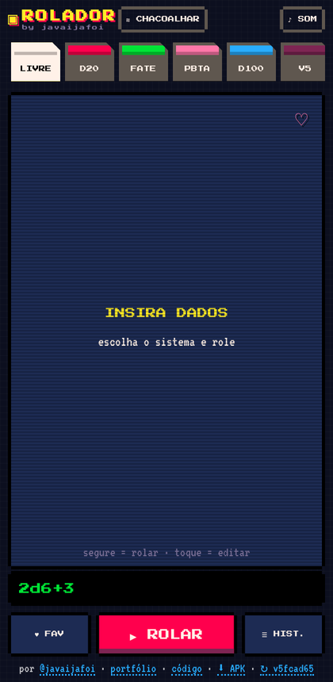
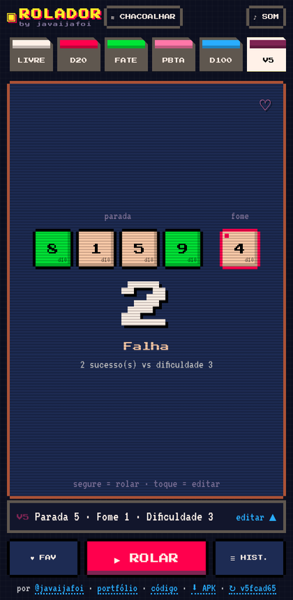

<div align="center">

# 🎲 Rolador

**Rolador de dados para RPG de mesa com cara de PICO-8.**
Escolhe o "cartucho" do sistema, ajusta os números e rola.

[](https://rolador-javaijafoi.vercel.app)
[](https://rolador-javaijafoi.vercel.app/rolador.apk)


 &nbsp;&nbsp;


</div>

## 🕹️ Sistemas

| Cartucho | Sistema | O que faz |
| --- | --- | --- |
| LIVRE | Qualquer um | Notação completa (veja abaixo), atalhos de dados e média/mín/máx |
| D20 | D&D 5e, Tormenta20, Pathfinder | d20 + mod contra CD, vantagem/desvantagem, 20 e 1 naturais |
| FATE | Fate Core, #iHunt | 4dF + perícia + invocações, escada Fate e tensões |
| PBTA | Apocalypse World, Dungeon World... | 2d6 + atributo, faixas 10+ / 7–9 / 6- |
| D100 | Chamado de Cthulhu 7e | d100 com dados de bônus/penalidade, regular/difícil/extremo/desastre |
| V5 | Vampiro: A Máscara 5ª ed. | Parada de d10 com dados de Fome, pares de 10, crítico bagunçado, falha bestial |
| WOD | Storyteller clássico | Parada de d10 contra dificuldade, 1 anula sucesso, especialização |
| SR | Shadowrun 5e/6e | Parada de d6, acertos em 5–6, glitch, regra do 6 |
| SWADE | Savage Worlds | Dado de característica + dado selvagem, explosões, ampliações, olhos de cobra |
| BLADES | Blades in the Dark | Pega o maior d6, crítico com dois 6, parada zero |
| DUALITY | Daggerheart | d12 de Esperança + d12 de Medo, vantagem em d6 |
| 3D6 | GURPS | 3d6 abaixo do NH com sucesso decisivo e falha crítica |

## ✍️ Notação livre

- `2d6+3`, `1d8-1d4-2`: soma e subtrai parcelas
- `4d6kh3` mantém os 3 maiores, `kl` os menores, `dl1`/`dh1` descartam
- `2d20kh1` vantagem, `2d20kl1` desvantagem
- `3d6!` explode no máximo, `1d6!!` explosão somada
- `1d20r1`, `4d6r<3` rerrola
- `8d10>=7` conta sucessos
- `d%` é d100, `4dF` são dados Fate

O link da página guarda a última rolagem livre (`/#4d6kh3`), então dá para mandar para a mesa.

## ✨ Detalhes

- Aleatoriedade via `crypto.getRandomValues`, sem viés de módulo.
- Histórico, sistema escolhido e valores ficam só no `localStorage` do navegador. Não há backend.
- Sons chiptune gerados com WebAudio.
- Favoritos, histórico e uma chacoalhada para rolar no celular.

## 🛠️ Rodando

```sh
npm install
npm run dev     # desenvolvimento
npm test        # testes das regras
npm run build   # build de produção
```

## 🤖 App Android (APK)

O app web é empacotado com [Capacitor](https://capacitorjs.com), sem depender de internet (fontes e código vão dentro do APK).

```sh
npm install
npm run apk   # gera android/app/build/outputs/apk/debug/app-debug.apk
```

Precisa de JDK 17+ e do Android SDK (`ANDROID_HOME`). O APK sai assinado com a chave de debug: serve para instalar direto no celular (permita "instalar apps desconhecidos"). Para atualizar, instale por cima um APK gerado na mesma máquina; se vier de outra, desinstale antes.

---

## 🌴 Mais do Peter

Este projeto faz parte do [**portfólio do Peter**](https://javaijafoi.vercel.app), uma vitrine de jogos, histórias interativas e experimentos com IA, todos no ar. Perfil no GitHub: [@javaijafoi](https://github.com/javaijafoi).

| Projeto | No ar | Código |
| --- | --- | --- |
| **Antigravitus**: Diário de aventuras num RPG de texto, jogado por agentes de IA | [abrir](https://antigravitus.vercel.app) | [repo](https://github.com/javaijafoi/antigravitus) |
| **Picotron Arena**: Dez modos de arcade num computador de fantasia | [abrir](https://picotron-arena.vercel.app) | [repo](https://github.com/javaijafoi/picotron-arcade) |
| **Jogo do Davi**: Jogo para crianças aprenderem a ler e a contar | [abrir](https://jogo-davi.vercel.app) | [repo](https://github.com/javaijafoi/Jogo-davi) |
| **Matusalém**: História interativa de mistério no Bixiga | [abrir](https://matusalem-six.vercel.app) | — |
| **Era Vargas: O Equilibrista**: Jogo 3D de decisões sobre o Brasil de 1930 a 1945 | [abrir](https://era-vargas-seliga.vercel.app) | [repo](https://github.com/javaijafoi/era-vargas-seliga) |
| **Pinta-Kara**: Desenhe no ar com as mãos, só com a webcam | [abrir](https://pinta-kara.vercel.app) | [repo](https://github.com/javaijafoi/pinta-kara) |
| **iFone**: Celular de mentira para mesas de #iHunt | [abrir](https://ifone-javaijafoi.vercel.app) | [repo](https://github.com/javaijafoi/ifone) |
| **Pico Poetry**: Poemas em pixel para sortear e compartilhar como imagem | [abrir](https://pico-poetry.vercel.app) | — |
| **#iHunt Chronicle**: Mesa virtual para o RPG #iHunt (em pausa) | [abrir](https://ihunt-chronicle.vercel.app) | — |
| **iHunt App**: Fork do Fari App (Fate) para mesas de #iHunt | — | [repo](https://github.com/javaijafoi/iHunt-app) |

---

Começou como um fork do [dice-roller do SeanMcP](https://github.com/SeanMcP/dice-roller); esta versão foi reescrita do zero.
Feito por [@javaijafoi](https://github.com/javaijafoi) · parte do [portfólio](https://javaijafoi.vercel.app).
